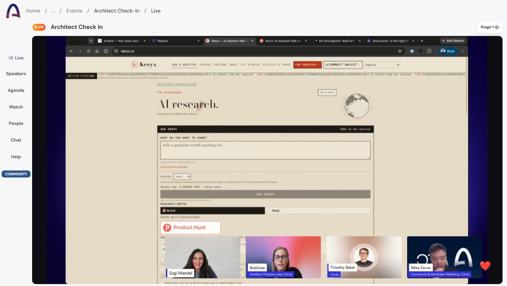

# Keryx — Tameion submission and evidence

Keryx connects original-source research, practical writing outputs, durable tasks
and creator payments across web, Windows, CLI and agent integrations. A question
and budget lead to visible source decisions, a cited report and inspectable USDC
settlement on Arc.

**[Submitted demo — 2:47, English narration and subtitles](https://youtu.be/sNonqLPMysg)** ·
**[Live product](https://keryx.cc)** · **[Reviewer route](reviewer-start.md)** ·
**[Windows/MCP release](https://github.com/tang-vu/keryx/releases/tag/v0.27.63)** ·
**[User workflow video — Hoàng](https://github.com/tang-vu/keryx/releases/download/v0.27.63/hoang-keryx-mcp-user-workflow-20261002.mp4)** ·
**[User workflow video — 0xacee](https://github.com/tang-vu/keryx/releases/download/v0.27.63/0xacee-keryx-user-workflow-20261012.mp4)** ·
**[User research paper — Trần Minh Hiếu](https://github.com/tang-vu/keryx/releases/download/v0.27.63/hieu-keryx-research-pilot-20261013.pdf)**

The owner confirmed submitting the Google Form on **October 13, 2026**. The
submitted code comparison is frozen from the September 25 pre-event baseline to
the submitted October 13 source:
[2291753…92733ec](https://github.com/tang-vu/keryx/compare/2291753cc4fff2135d546227d5aafda287cbed7d...92733ecc6dfb5076815c2a29de6370c02a84845c).
Later main commits remain visible in the repository and are not silently added
to that submitted comparison.

## Community recognition

On **October 16, 2026**, the Arc team gave Keryx a shoutout at the
[Architect Check-in](https://community.arc.io/public/clubs/architects/events/architect-check-in-u1f8k3tkdy).
Keryx was one of approximately **3–4 projects shown** during the event. The shoutout
and approximate project count were confirmed by the owner on October 17; the
linked event page provides the event reference.

*Owner-supplied screenshot showing Keryx on screen during the session.*

## Event-period product delta

The event began September 27. The existing citation-toll service has been developed
solo since June 2026. Earlier Canteen/Circle awards were Agora Standout for
ReasoningReceipt ($625), and Lepton 1st Place for Keryx ($10,000) plus Committed
Builder ($250). These are prior awards, separate from Tameion results and revenue.

| Capability built or expanded during Tameion | What a user or builder gains | Source and scope |
| --- | --- | --- |
| Windows desktop and durable task CLI | Private workspaces; Quick/Deep task preparation; pinned seller, network and cap; original-job recovery; offline saved answers; native brief/reference exports | [Desktop](desktop-alpha.md), [task alpha](operator-task-alpha.md); shared Rust task creation, Tauri/WebView2 shell and deliberate buyer handoff |
| Original public-web and scholarly reading | Bounded original HTML/PDF reads, exact Crossref DOI/arXiv discovery and explicit read limits | [Scholarly research](scholarly-research.md); metadata and public references retain their own evidence/payment roles |
| Literature and writing workflow | Paper screening, notes, editable comparisons, retained-excerpt related-work drafts and supplied-text citation checks | [Literature workspace](literature-workspace.md), [evidence drafts](evidence-drafts.md), [draft check](draft-check.md) |
| Research exports | Respective Markdown/LaTeX, BibTeX/RIS, CSL-JSON and evidence CSV outputs | [Researcher exports](researcher-exports.md), [checked bibliography](engineering/checked-bibliography-exports-2026-10-09.md); bibliography-only records stay distinct from read/cited evidence |
| Visible economic decisions | BUY/SKIP/CACHE and stops under separate source-USDC and attention caps; cached reads retain their attention cost | [Decision review](engineering/decision-review-253.md), [research audit contracts](engineering/research-decision-audit-2026-10-09.md) |
| Arc mainnet and creator authority | Production cutover October 4; source/version, publishing-control and payout checks; creator-signed V3 registration, gas-sponsor policy and original-transaction recovery | [Mainnet status](mainnet-status.md), [registration sponsorship](creator-registration-sponsorship.md); sponsor availability depends on installed policy and funds |
| Prepaid business Operator | Obligation, capacity and Gateway-liquidity checks; retained pre-claim decision and outcomes; original-order/creator-ledger result repair | [Business Operator](operator-business.md); independently accepted paid fulfillment remains a validation milestone |
| Bounded Research Monthly | Four manual Deep requests over 30 days, 10% below four separate packages, with unchanged creator caps | [Monthly terms](research-monthly.md); manual renewal and existing entitlement/quote checks, with live purchase acceptance separate |
| Agent and developer entry points | Shared research/evidence contracts through API, remote/stdio MCP, client adapters, extension and chat bots | [Supported-surface roles](surface-parity.md); authentication and spending roles remain specific to each adapter |
| Decision Lab and signed offline exports | Inspect model proposals, selected plans, execution rules and observations; separately keyed Ed25519 exports and bounded what-if inspection | `/operator/decisions`, [decision audit](engineering/research-decision-audit-2026-10-09.md); integrity does not establish factual correctness |
| Economic replay and supplied-review/cost analysis | Inspect recorded budget/allocation arithmetic and relate supplied claim reviews to supplied source/provider costs | [Research evidence audit](research-evidence-audit.md); newer merged work, with unknown values and USD/USDC kept distinct |
| Recorded purchase outcomes | Compare exact-version purchases against citations, with a bounded sample/window and separate outside/team/scripted/unknown cohorts | [Purchase outcomes](engineering/purchase-outcomes-298.md); recorded uncited spend is descriptive and does not establish missed value |
| Missing-evidence procurement | Define a research gap, compare provider-signed quotations using integer micro-USDC budgets, inspect signed supporting/refuting deliveries | [Procurement](evidence-procurement.md); portable prototype, funded provider execution remains a next stage |
| Reusable Arc components | Exact money/allocation, two-toll x402, durable journal interfaces, registry indexing, budget reservations and withdrawal helpers | [Separate MIT library](https://github.com/tang-vu/keryx-arc-primitives), [accepted refresh](arc-primitives-maintenance.md); testnet defaults and explicit host duties |

After the submitted comparison, [PR #455](https://github.com/tang-vu/keryx/pull/455)
also merged owner-bound completed-private-read import into evidence drafts. It
reuses the retained job and exact excerpts through explicit selection/import;
the [source record](engineering/completed-evidence-draft-283-20261013.md) retains
its privacy and evidence boundaries. It awaits the next production batch.

## October 13 traction snapshot

These are the retained submission observations, rather than an October 14 live
recount. Financial activity, directly identified users and distribution are
reported separately with their own windows.

| Channel | Observation | Window / counting rule |
| --- | --- | --- |
| Arc mainnet activity | 129 recorded questions; 15 accounts; 87 guest questions included in the total | October 13 database snapshot; accounts/questions are not a unique-human count |
| Arc mainnet settlement | 40 settled payment records totaling 0.703750 USDC | October 13 database snapshot; all caller origins including owner/QA, gross volume rather than revenue |
| npm | 2,333 Tameion downloads; +1,434 since the previously reported October 4 total of 899 | September 27–October 12; 3,241 lifetime downloads since June 23; automated/repeat installs can contribute |
| Website | Approximately 1,000 visits and 1,180 page views, Cloudflare Exclude bots enabled | Owner-supplied 21-day snapshot on October 13; visits rather than unique people |
| GitHub | 33,649 clones, 1,537 unique cloners, 766 views, 46 unique visitors; 3 stars and 1 fork | Owner-supplied 14-day snapshot on October 13; clones can include CI/automation |
| X / Product Hunt | 46 @keryxpays followers; more than 20 posts, likes and several thousand cumulative views; interested comments; 8 Product Hunt upvotes | Owner-supplied October 13 snapshot |
| Discoverability | 126 backlinks from 47 linking websites; listings include Glama and Trendshift | Owner-supplied cumulative Ahrefs snapshot; event-period growth not established, catalogs/mirrors may contribute |
| Direct users | At least four identified outside users, spanning app development, academic research and SaaS discovery | Verified minimum; stories and matched evidence below |

[npm event-period data](https://api.npmjs.org/downloads/point/2026-09-27:2026-10-12/keryx-mcp),
[npm lifetime data](https://api.npmjs.org/downloads/point/2026-06-23:2026-10-12/keryx-mcp),
[public activity](https://keryx.cc/dashboard) and [current metrics](https://keryx.cc/api/metrics).
Public discovery examples: [Glama](https://glama.ai/mcp/servers/tang-vu/keryx),
[Trendshift](https://trendshift.io/repositories/81301).

The owner also reported 27 project-related contacts/interactions across three
email accounts, excluding seven generic promotional messages. These include
organizer relationships, product discussions, event invitations and service
offers across periods; conversion to paying use is unestablished. Arc Office Hours,
the Arc Discord Builder/Arc House Architect roles and a Canteen fireside/showcase
invitation provided feedback and collaboration opportunities. They are community
participation, not endorsements. Repeat use and accepted outcomes remained the
next validation targets at that checkpoint. The separately dated
[October 15 return task](#return-task-from-0xacee-on-october-15) adds an
owner-confirmed further use by an existing participant.

## Event-period usage: testnet week, then mainnet

Production moved from Arc testnet to mainnet on October 4. The retained event-period
testnet snapshot covers September 27 00:00–October 2 17:01 UTC: **258 completed
research runs, 304 settled payment records and 2.086750 test USDC**. All caller
origins, including internal activity, are included. The unobserved interval to the
cutover is not extrapolated or added to the mainnet snapshot above.

The separate June 15–October 2 archive records **3,280 questions, 11,314 settled
creator payments, 56.748064 test USDC and 23 paid creator wallets**. It includes
owner-operated activity and pre-event history. [The original testnet archive](https://keryx.cc/history/testnet)
retains its network and evidence; lifetime totals are not new event growth.

### Named external user: Hoàng, freelance developer

Hoàng is a freelance developer building the Face Marker app. On October 2 he used
Keryx through the MCP server inside Devin CLI to research questions for that app:
facial-analysis methods, privacy and app-platform policies, and MediaPipe Face
Landmarker. He is outside the Keryx team. His identity and workflow were published
by the owner with a screen recording on X ([@tangvu_dev](https://x.com/tangvu_dev),
October 2) and in the October 3 Canteen traction update. The owner confirmed on
October 14 that the X account is suspended. The retained edited MP4 has now been
restored from the original local archive:
[watch the 1:53 recording](https://github.com/tang-vu/keryx/releases/download/v0.27.63/hoang-keryx-mcp-user-workflow-20261002.mp4) ·
[recording scope and SHA-256](https://github.com/tang-vu/keryx/releases/download/v0.27.63/hoang-keryx-mcp-user-workflow-20261002.txt).

The edit uses chronological cuts at normal speed, enlarges the terminal, adds
English chapter labels and retains original audio. Unsupported policy answers,
the connection error/retry and partial low-confidence MediaPipe result remain
visible. The original October 2 edit reported the CLI's payment state; the later
October 3 Circle and chain verification below is separate evidence.

| Field | Value |
| --- | --- |
| Participant | Hoàng — [GitHub](https://github.com/Hoang130203), [LinkedIn](https://linkedin.com/in/ho%C3%A0ng-mai-minh-93a5852aa/) |
| Origin | Independent freelancer; his own app and his own questions |
| Surface | Keryx MCP in Devin CLI, Arc testnet |
| Video | 113-second archived recording, restored October 14; original X publication remains unavailable |
| Runs | Three research runs: `3a43c6c2-fddf-40ce-98a1-701a2a58b439`, `fe7c06fd-65da-41a6-867c-0597a63304df`, `2405a2ea-7ee3-4f0d-88b9-f221df791070` |
| Payment | One source-access payment of 0.002 USDC to the Conzit Labs source; the other two runs bought nothing |
| Payer | Keryx treasury. The run was sponsored; Hoàng did not fund a wallet |
| Circle record | Transfer `09ab0e57-bb5e-43a0-90e4-194e181de1be`, completed, exact match on payer, payee, network, asset, amount and nonce |
| Chain record | Batch `0x565dd6fbdaec636e8528dd8a0f72eb6fe6c68513c8e60b2993805f7756929b60`, finalized in Arc testnet block 65095204 |
| Result quality | Real workflow with visible evidence gaps, as stated in the public post |

Limits of this record:

- The database row does not carry Hoàng's name or the Devin client; that attribution
  comes from the owner's public account of the session and the recording.
- The payment was sponsored, so it shows real use by an outside person, not an
  outside wallet paying.
- The three original run URLs are restored through a read-only, explicitly labeled
  [testnet archive](https://keryx.cc/history/testnet). Their recorded payment states
  remain frozen at capture time; the later Circle and chain checks above are separate
  evidence. See [history restoration and limits](historical-testnet-archive.md).
- No repeat use by Hoàng after October 2 is recorded here.

### Other outside users

These people are outside the Keryx team and used Keryx for their own work. The owner
supplied their identities and use cases on October 8 and confirmed that all three
agreed to be named.

| Person | Who they are | What they used Keryx for | Surface |
| --- | --- | --- | --- |
| [@JamWaveX](https://t.me/JamWaveX) (Telegram) | International student in China preparing for a master's programme | Scientific research for the master's application | Not recorded |
| [Trần Minh Hiếu](https://www.linkedin.com/in/tr%E1%BA%A7n-minh-hi%E1%BA%BFu-667915335/) | Fourth-year university student | Undergraduate research for a scholarship application; a later 65-report working paper is linked below | Sponsored Deep research for the working paper |
| [0xacee](https://github.com/0xacee) | Builder working on a SaaS product | Finding a product niche; later storage/backup and VoiceReady documentation tasks are recorded below | Keryx API; later web sessions |

Limits of these records:

- Run IDs and payment legs for @JamWaveX, Hiếu's earlier scholarship-research
  story and the earlier SaaS-niche session are not matched in this pack yet.
  Hiếu's working-paper package retains its own 65 report IDs and receipts; the
  later 0xacee recording has three report IDs below. Participant attribution
  remains owner-confirmed rather than established by a name in the stored runs.
- Participant attribution comes from the owner-confirmed stories. A matched
  research record and an outside wallet funding that record are separate facts.

### Feedback reported on October 16

The owner confirmed useful outcomes from **0xacee, Hoàng and Trần Minh Hiếu**,
summarizing their common feedback as research that helped solve their tasks,
quickly and at low cost. The [dated feedback record](case-studies/user-feedback-2026-10-16.md)
connects that qualitative owner-relayed feedback to their documented work. These
are already identified participants; no new user or payment total, measured
speed/cost comparison or accepted paid business cycle is inferred.

Other people have contacted the owner through X, LinkedIn and Product Hunt and are
added here as their use is recorded.

### Research artifact: Trần Minh Hiếu

[Read the four-page working paper](https://github.com/tang-vu/keryx/releases/download/v0.27.63/hieu-keryx-research-pilot-20261013.pdf) ·
[Reproduce from the frozen data and code](https://github.com/tang-vu/keryx/releases/download/v0.27.63/hieu-keryx-research-pilot-20261013.zip) ·
[Artifact scope and SHA-256](https://github.com/tang-vu/keryx/releases/download/v0.27.63/hieu-keryx-research-pilot-20261013.txt)

On October 14 the owner confirmed that **Trần Minh Hiếu conducted this research
himself**. His working paper, *Paid source access and evidence coverage in a
sponsored research agent*, turns Keryx use into a concrete research output:
methods, quantitative tables, two figures, sensitivity analysis and a frozen
reproducibility package. It examines whether source-access charges and citation
rewards are sufficient signals of complete recorded evidence coverage.

| Field | Retained evidence |
| --- | --- |
| Researcher | Trần Minh Hiếu, an already documented outside user; authorship and self-conducted research confirmed by the owner |
| Corpus | 65 retained Keryx Deep reports, 202 recorded research targets; receipts created October 11–13 |
| Snapshot | October 13, 2026, 16:30:46 UTC; 65 completed reports from 68 journaled submissions |
| Research output | Four-page working paper, report/target CSV and JSON tables, figures, original public report links and receipt manifests |
| Reproduction | Four analysis tests and a local verifier reproduce the frozen report, target and monetary aggregates without another research purchase |
| Funding and assistance | Sponsored public Deep requests; AI-assisted analysis and writing; no participant-funded purchase established |

The October 14 edition corrects the earlier unnamed "owner-operated" attribution
to name Hiếu and describe his user-led study. The original PDF is retained locally;
the frozen receipts, datasets, figure inputs and conclusions are unchanged.

This is evidence of a documented user's research activity and produced artifact.
The coverage proxy remains system-reported, with no blinded factuality evaluation
or peer review; receipt consistency does not independently verify external payment
settlement. Hiếu was already included in the four-person minimum. These 65 reports
and their recorded source payments are not additional totals to add to the dated
mainnet activity snapshot.

### Recorded outside-user workflow: 0xacee

[Watch the English recording, 3:05](https://github.com/tang-vu/keryx/releases/download/v0.27.63/0xacee-keryx-user-workflow-20261012.mp4) ·
[Subtitles](https://github.com/tang-vu/keryx/releases/download/v0.27.63/0xacee-keryx-user-workflow-20261012.srt) ·
[Recording scope and SHA-256](https://github.com/tang-vu/keryx/releases/download/v0.27.63/0xacee-keryx-user-workflow-20261012.txt)

On October 14 the owner confirmed that 0xacee directly ran or supervised this
October 12 session for a news-monitoring application's storage and backup design.
The footage shows actual Keryx browser research and inspection of original SQLite
wording, followed by a prototype design note. English narration/captions were added;
waiting gaps were shortened and some scene endings held.

| Research task | Retained report | Observed outcome |
| --- | --- | --- |
| Vietnamese WAL and backup question | [2912b7db](https://keryx.cc/dispatch/2912b7db-666b-4233-8322-19300f227287) | Partial backup evidence; two WAL targets lacked qualifying evidence |
| Narrower English WAL question | [e2c8a5d2](https://keryx.cc/dispatch/e2c8a5d2-629e-40e1-a0dd-b9be004a9b15) | Official excerpts about concurrent readers and the one-writer limit; confidence boundary retained |
| Backup-only supplementary question | [51a10b2e](https://keryx.cc/dispatch/51a10b2e-7295-4696-a4f4-b2ea1cf71bbd) | Evidence-review output limit; no supported answer delivered |

The hosted app was **0.27.62** during recording; **0.27.63** was the observed GitHub
release. The zero-source-budget sponsored session has no recorded creator payments.
Six SQLite checks shown later were run separately by an assistant with synthetic
data; they establish those prototype checks, not Keryx execution or independent
human validation of research quality. The recording's closing label retains that
validation limit. The owner-confirmed participant involvement is distinct from it.
This is another documented workflow for an already identified user, not a fifth user.

### Return task from 0xacee on October 15

[Watch the English recording, 2:23](https://github.com/tang-vu/keryx/releases/download/v0.27.63/0xacee-voiceready-keryx-return-20261015.mp4)
· [Recording scope and SHA-256](https://github.com/tang-vu/keryx/releases/download/v0.27.63/0xacee-voiceready-keryx-return-20261015.txt)

[Read the short case study: problem, useful evidence and application](case-studies/voiceready-2026-10-15.md).
It connects this return task to the earlier session and keeps research outcomes,
companion measurements and customer acceptance distinct.

On **October 15, 2026**, the owner identified an additional VoiceTake/VoiceReady
project as 0xacee's work and supplied its retained local package. Together with
the October 12 session above, this records **owner-confirmed return use on a new
task**. The package records assistant-assisted implementation and validation;
participant attribution comes from the owner, rather than from the stored runs.
The identified outside-user minimum stays four.

VoiceReady is a local companion that normalizes a VoiceTake narration export
and previews the original and processed files. Keryx was used to research its
documentation contracts:

| Question | Retained report reference | Recorded outcome |
| --- | --- | --- |
| FFmpeg loudness-normalization contract | [b48df208](https://keryx.cc/dispatch/b48df208-76ac-4f42-94c3-beb36c2dc730) | Earlier ordinary-page admission and default-model selection attempts were refused. An optional Pro-model run saved this report but delivered no supported answer because the supplied original could not be read. |
| Browser object-URL cleanup, with the original MDN page supplied | [c2febd88](https://keryx.cc/dispatch/c2febd88-a367-432a-8b90-4214f1f82e44) | Retained passages support what revocation does and when to release a reference. The result retains its Moderate source-grounding boundary. |

The MDN evidence informed review of the audio-preview lifecycle. Detaching the
player and releasing URLs on replacement/clear, normalization code and behavioral
checks were performed separately by an assistant. The companion's retained
measurement records a change from **−29.07 to −16.41 LUFS**, with the original
**153.667-second**, 48 kHz mono PCM16 duration/format preserved. Those measurements
describe VoiceReady's output, separately from Keryx's research result. Human
listening review and use of the output in a finished customer deliverable remain
unconfirmed.

The **2:23 English video** uses actual browser captures, shortened waits,
held views, AI narration and burned captions. It preserves the failed research
attempts and the useful narrower answer. Its SHA-256 is
`9b4b8b1994841fecb2ea08ad195cf08d6c1bd67d87d0e909a38936a353d05e0d`.
The local package includes the companion source, measurements, audio and browser
checks. The owner approved video publication on October 15; the downloaded
published video matches the retained hash. The complete project/audio package
remains local. Anonymous report readback returned HTTP 503
during the existing October 15 production maintenance window, so public answer
availability was not established by this check.

The technical questions used a **0 USDC source cap** and sponsored model/search
usage. The retained settlement projections record zero spend and no payment rows.
The audio was an existing catalog-voice inference export and was processed locally;
no audio was sent to Keryx. This adds a documented return task without changing
the dated payment totals or establishing paid repeat demand, a customer testimonial
or an independently accepted complete business workflow.

## Observed delivery and supported surfaces

An early read-only public-health check on **October 14, 2026** reported operational/db
ok, Arc mainnet and deployed commit `ec5f39c9`. The recorded full source is
`ec5f39c9750dfc9e80e66edd41348ca6034c01c3`, application **0.27.63**.
[Mainnet status](mainnet-status.md) retains the release/maintenance evidence.
At that check, public npm metadata reported **keryx-mcp 0.4.19**. The
[v0.27.63 release](https://github.com/tang-vu/keryx/releases/tag/v0.27.63) exposes the
MCP tarball/source manifest and Windows **0.4.17** installer/portable ZIP/checksums,
whose manifests name that full source. This refresh checked discovery/manifests;
it did not repeat a fresh installation or package acceptance trial.

| Surface | User role | Boundary |
| --- | --- | --- |
| Web | Questions, cited reports, source decisions, literature tools, creator flow and inspection workspaces | Newer merged source can await deployment; submitted questions use the disclosed payer/budget |
| Windows desktop | Private task preparation, shared CLI files, original-job recovery, offline results and native exports | Explicit buyer/web handoffs; no renderer wallet signer or autonomous scheduler |
| Repository CLI | Task workspace/create/status/resume/result/export/brief and buyer workflow | Pin quote/network/payee/cap; journal original authorization before submission; GET-only recovery |
| API / A2A / OpenAI-compatible | Hosted research, packages, jobs, receipts and exports | Public and private delivery retain their own authentication contracts |
| Remote MCP | Hosted agent access and shared research/evidence tools | Hosted auth/spending roles; no local custody |
| Stdio MCP | Published caller-funded client and original-request recovery | Caller provides wallet and merchant policy; no automatic funding |
| Browser extension | Existing browser research/registration entry points | Thin adapter, separate package/store status; hosted handoffs |
| Discord / Telegram / Slack | Existing chat research adapters and report links | Each adapter keeps its own authentication and sponsored-service role |

The submitted source comparison ends at `92733ecc`; main also includes later
merged improvements. A later October 14 read-only health check reported
operational Arc mainnet at `ae298ff4`. The client observations above retain their
earlier source identity. Compare current health and release manifests with source
before treating later changes as deployed. Source or downloadable artifacts alone
do not establish independently accepted work.

A read-only health check on October 16, 2026 at 08:22 UTC reported operational
Arc mainnet at `2dda3717`. That source's package version is 0.27.70, and its
registry address is V3 `0x2217250019ab614dae7391d346d05c3fc4d71ae1`. The October
14 client manifests above keep their own versions. Monitoring on the October 16
response was incomplete, with observation checks last recorded on October 6.
See [mainnet status](mainnet-status.md).

## Arc OSS: components other builders can use

The separate [keryx-arc-primitives](https://github.com/tang-vu/keryx-arc-primitives)
repository is MIT-licensed and refreshed to **0.3.0** during Tameion. Its built ESM
exports, TypeScript declarations, offline demo and consumer checks support reuse of
integer micro-USDC parsing/allocation, fixed/computed two-toll x402 flows with
required durable journals, creator-bound registry/indexing helpers, an atomic
budget-reservation reference and signed withdrawal helpers.

Alongside [Circle's Arc Nanopayments reference](https://github.com/circlefin/arc-nanopayments),
Keryx adds the research workflow around a transfer: select useful information,
separate access from citation rewards, require exact evidence and preserve the
original paid request across interrupted delivery. Local task/receipt recovery,
research exports, creator registration and decision/procurement examples are
additional application patterns, distinct from the standalone exported API.
The extraction keeps testnet defaults; hosts own durability, custody,
reconciliation and funded acceptance. [Maintenance and accepted scope](arc-primitives-maintenance.md).

## Public addresses

Only public API/configuration values are reproduced. The registry rows match
health at `2026-10-16T08:22:29.241Z` on Arc mainnet, `eip155:5042`. Gateway and
USDC addresses are the pinned mainnet profile. The former October 2 testnet
address table remains in Git history, on its original rail. Merchant and treasury
identities are read from the selected role's public response. An earlier
documentation check found the Monthly quote unavailable; this October 16 refresh
did not request a new quote. Creator `payTo` and session addresses vary per
source or user and must be captured for the actual workflow.

| Role | Full public address | Public source / explorer |
| --- | --- | --- |
| SourceRegistry V3 | `0x2217250019ab614dae7391d346d05c3fc4d71ae1` | [Health](https://keryx.cc/api/health), [explorer](https://explorer.arc.io/address/0x2217250019ab614dae7391d346d05c3fc4d71ae1) |
| SourceRegistry V1, retained October 4 authority | `0x42a64061b6cd84067bb660b2a9b8aa881fd225bb` | [Explorer](https://explorer.arc.io/address/0x42a64061b6cd84067bb660b2a9b8aa881fd225bb). The recorded walkthrough payout check still reads this contract. Health does not. |
| Settlement treasury balance identity | Read the current selected-role public projection | [Treasury API](https://keryx.cc/api/treasury); availability is separate from health |
| Research Monthly quote merchant/payee | Current quote unavailable at this check | [Public quote](https://keryx.cc/api/research/monthly?quote=1); do not reuse the historical testnet payee |
| USDC token | `0x3600000000000000000000000000000000000000` | [Public network profile](../lib/arc-network-profile.ts), [explorer](https://explorer.arc.io/address/0x3600000000000000000000000000000000000000) |
| Circle Gateway wallet contract | `0x77777777Dcc4d5A8B6E418Fd04D8997ef11000eE` | [Public network profile](../lib/arc-network-profile.ts), [explorer](https://explorer.arc.io/address/0x77777777Dcc4d5A8B6E418Fd04D8997ef11000eE) |
| Circle Gateway minter contract | `0x2222222d7164433c4C09B0b0D809a9b52C04C205` | [Public network profile](../lib/arc-network-profile.ts), [explorer](https://explorer.arc.io/address/0x2222222d7164433c4C09B0b0D809a9b52C04C205) |

## Historical checkpoints

The following October 4–8 observations retain their dates and original limits.
Use the October 13 snapshot and October 14 release observation above for this
submission refresh.

Earlier deployment, QA and entry checkpoints

### Earlier event-period usage snapshot

Tameion began on September 27. Keryx ran on Arc testnet for the first week of the
event and moved production to Arc mainnet on October 4. Both phases are event-period
usage and are reported separately, never added together.

| Phase | Window (UTC) | Research runs | Settled payments | USDC | Counting rule |
| --- | --- | --- | --- | --- | --- |
| Arc testnet | Sep 27 00:00 – Oct 2 17:01 | 258 completed | 304 source-access and citation-reward payments | 2.086750 | One read-only production snapshot; all caller origins, internal activity included. No pending, failed or simulated payments in the window. |
| Arc mainnet | Oct 4 – Oct 8 15:05 | 50 recorded | 7 | 0.095, of which 0.065 to 2 creators | [Public metrics](https://keryx.cc/api/metrics) and [run history](https://keryx.cc/api/runs); all caller origins. |

Testnet activity between October 2 17:01 and the October 4 cutover is not in the
snapshot and is not counted. Cumulative lifetime figures include activity before
the event and are not event traction.

On mainnet, [Operator status](https://keryx.cc/api/operator/status) at
`2026-10-08T15:05:07Z` reported one completed and zero failed jobs over 24 hours,
with two registered creator sources.

## October 8 evidence and deliverable checkpoint

At `2026-10-08T09:02:01.625Z`, [public health](https://keryx.cc/api/health)
reported operational/db ok, Arc real settlement at `ab2195d6`/app0.27.35.
At `2026-10-08T09:09:06.126Z`, [public metrics](https://keryx.cc/api/metrics)
projected47 queries, six settled payment records totaling0.07USDC, creator
payouts0.04USDC, two earning creators, zero settled operating fees and12 recorded
accounts. These are database projections, not independent-customer counts or a
new settlement performed by this review. Two feedback records cannot establish
general satisfaction; aggregate factual grounding remains unavailable.

The [four owner-operated real-client tasks](https://github.com/tang-vu/keryx/issues/128#issuecomment-6053576966)
reported two partial results and two no-answer results, with no complete accepted
deliverable. They are QA, not four external customers or a population failure rate.
The [app0.27.39 deliverable candidate](engineering/research-deliverable-quality-2026-10-08.md)
repairs the retained MDN evidence omission and stages bounded ordinary presentation.
A separate three-call retained-body model trial recovered all four requested MDN
facts in Portuguese, but initially failed the three-item format. Its unchanged
reviewed output is used for a deterministic presentation regression; this is not a
new full research/production acceptance trial or independent adoption. The candidate
does not establish original Operator fulfillment or deployment.
PR240 retains its separate owner, financial continuation and admitted source window.

Before recording the competitive demo, require useful original-task delivery,
inspectable BUY/SKIP/CACHE reasoning, exact settlement receipts and honest event
delta. Then collect accepted real use and repeat use from a narrow relevant user
group. Do not turn simulations, own-business QA or historical feature counts into
independent traction. Historical checkpoints below remain unchanged.

## October 7 read-only evidence checkpoint

At `2026-10-07T02:04:31.538Z`, [public health](https://keryx.cc/api/health)
reported operational/database ok, Arc mainnet and real settlement mode at
`c1cb8626`. [Public metrics](https://keryx.cc/api/metrics) subsequently reported
one settled payment totaling **0.03 USDC**, zero creator payouts and 28 stored
queries. The retained original is an owner-operated paid trial with unresolved
delivery; these figures establish neither independent business demand nor a
completed useful workflow. [Operator status](https://keryx.cc/api/operator/status)
at `2026-10-07T02:05:06.516Z` reported held/acceptance-paused, zero registered
creator sources and, over 24 hours, zero completed/one failed job. Recheck these
dated projections before recording or submission.

The organizer's three entry priorities are actual USDC flow on Arc through the
Circle stack, a project the builder intends to continue, and genuine business
use. [The official FAQ](https://tameion.thecanteenapp.com/) accepts an own-business
or maintained open-source use case; RFBs are prompts, not mandatory tracks.
That permits a genuine own-business research pilot, but does not make an internal
trial an accepted business outcome or independent traction. The immediate gate
remains delivery of the original paid task, owner acceptance against its actual
business decision, exact receipt/recovery evidence and a short recorded workflow.
All missing pilot proof fields below remain open; do not fill them from counts.

The 0.27.12 [failure-reporting candidate](engineering/synthesis-failure-2026-10-07.md)
makes unavailable synthesis distinguishable from missing document evidence. Its
code checks are not original fulfillment, a new settlement or usefulness proof.

October 6 candidate increment: [hosted business Operator](operator-business.md)
adds the prepaid revenue-to-delivery guard, audit and public observation. A real
complete business workflow, accepted deliverable and contract-enforced general
policy wallet still need evidence. Historical identities below are not candidate
deployment/publication proof; update them from fresh release readbacks.

The [finite canary](operator-canary.md) adds original-bound financial/provider
admission and recovery. Its internal owner run, funding and useful result are
still acceptance gates, not independent traction or a general on-chain wallet.

Historical October 4 preparation checkpoint against deployed source `1297d43`.
The submission status, demo and current release observations are updated above;
this historical checkpoint does not establish a completed customer pilot. [Active direction](tameion-2026.md),
[release gates](mainnet-delivery-plan.md), and [public changelog](project-changelog.md)
remain authoritative for scope and limitations.

## Entry and evidence boundary

Keryx is an agent-operated paid research service: a question and source budget lead
to visible BUY/SKIP/CACHE decisions, selected x402 reads, a cited deliverable, and
weighted USDC rewards for eligible creators actually cited. The Tameion goal is
one complete business workflow with payment, logs, delivered outcome and recovery.
The complete accepted business workflow, general onchain policy wallet and autonomous
scheduler remain separate milestones; the implemented hosted Operator is described above. No complete independent-business workflow is supplied
in this pack yet. Production is now Arc mainnet, observed through public health.
[Current status](mainnet-status.md) records the network/contracts and release identities;
launch does not prove an accepted business outcome or grant unlimited spending.

The [official event guidance](https://tameion.thecanteenapp.com/) requires a public
repository and a recorded demo **under three minutes**, encourages a live link,
and allows repeated submissions before the deadline. Submit via the
[official form](https://forms.gle/BBWrdfuircrKiG2i6) by October 17, 23:59 ET
(October 18, 10:59 Vietnam; extended from October 10, observed October 5). Repository: [tang-vu/keryx](https://github.com/tang-vu/keryx).
Live service: [keryx.cc](https://keryx.cc). Submitted video: [2:47 narrated demo](https://youtu.be/sNonqLPMysg).
Product and evidence-backed traction updates in Canteen, and showcase participation,
are separate from submitting this form. This document does not authorize posting,
contacting businesses, recording participants or submitting on their behalf.

## Next accepted paid-business workflow

The submitted 2:47 product demo and supporting user recording are linked above.
The following plan is retained for a future accepted paid-business workflow.
Use an actual consented business task and its original artifacts. If the
first run needs longer, record the genuine steps and disclose elapsed time/cuts.

| Time | Show | Required evidence |
| --- | --- | --- |
| 0:00–0:20 | Business, recurring problem and exact research question | Public identity and consent; classify own-business, sponsored or independent. |
| 0:20–0:45 | Quote, payer, network, source budget and approved limits | Actual authorization and payment source; separate service/search/model costs. |
| 0:45–1:25 | Agent choices and purchases | Real BUY/SKIP/CACHE trace, eligible creator identities, original order/dispatch IDs. |
| 1:25–1:55 | Useful cited result and business decision it informs | Delivered report and participant's accepted outcome, or explicitly pending acceptance. |
| 1:55–2:25 | Receipt, creator settlement and original recovery | Exact Circle references, settled/pending legs and GET-only recovery without repeat debit. |
| 2:25–2:45 | What changed during Tameion and remaining gates | Baseline comparison; honest network/Operator/Monthly/mainnet limitations. |

## Pilot intake and evidence record

The filled records are Hoàng's matched runs and payment, Hiếu's working paper,
and 0xacee's recorded workflow and October 15 return task, in
[Event-period usage](#event-period-usage-testnet-week-then-mainnet) above.
@JamWaveX is named without matched run IDs. The records above are the evidence
in this pack. A later participant needs a filled record of their own.

Own-business and small-team tracks are not filled. A later task needs its own
consent, question, payer, receipt, and acceptance record, stored privately where
the details are sensitive. This document does not perform outreach. Keep raw
signed payment headers, authorizations, and bearer signatures private.

For Circle nanopayments, an exact matched Circle record supports the individual
authorization. An Arc batch transaction receipt supports that batch; it does not
independently prove one nonce/recipient/amount unless decoded evidence establishes
the mapping. Do not relabel every facilitator reference as an onchain transaction.
See [receipt trust boundary](research-receipts.md) and
[withdrawal rehearsal evidence](engineering/creator-funded-withdrawal-drill.md).

Before submission, reconcile incoming payments, outgoing source/creator legs and
remaining obligations separately. Pending, failed, simulated and prepaid allocations
are not new settled value. Historical public totals are not event-period growth;
owner/sponsored activity is not independent demand. Baseline business/customer
counts, independent onboarded businesses, accepted jobs, return customers,
event-period settled value and mainnet revenue are **not established here**.
One real complete workflow is the immediate target; wider pilot targets remain goals.
